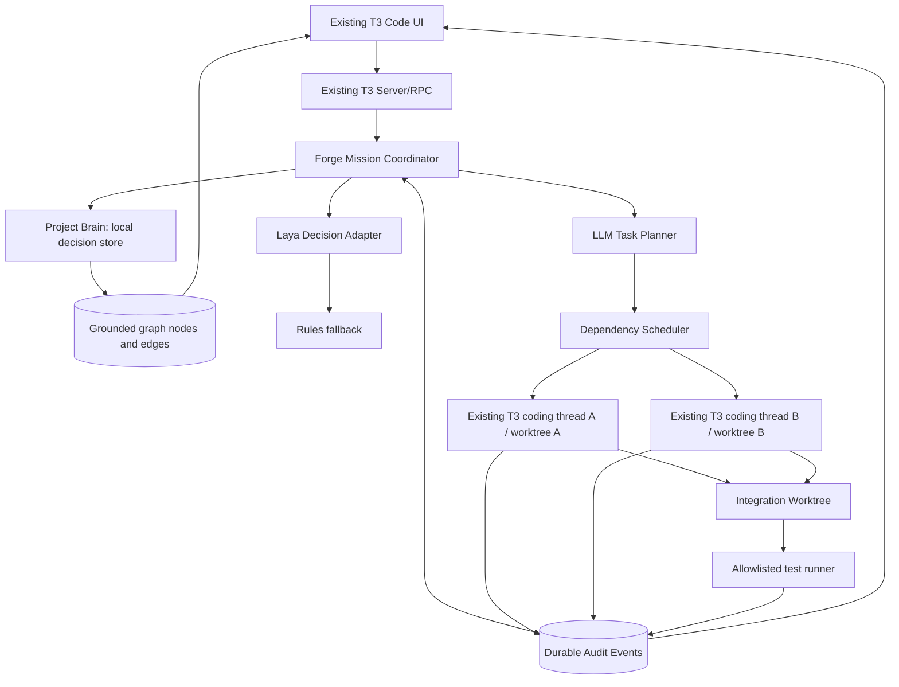

# T3 Forge — Product Requirements & Technical Design v4.0
**Subtitle:** Observable, memory-aware multi-agent software engineering with meaningful Laya decision intelligence  
**Status:** Hackathon build specification / proposed implementation; not a claim of completed features  
**Time budget:** Approximately 4 hours of implementation with Claude Code assistance  
**Primary target:** Best Open-Source AI Project (subject to organizer eligibility review)  
**Base:** Existing T3 Code fork; preserve upstream licensing and attribution

## 0. Executive decision and project summary

T3 Forge extends T3 Code with a transparent workflow that lets developers observe how coding agents share project context, coordinate implementation, and validate changes. Its distinctive contribution is a **causal, inspectable audit trail** tying decisions to agent behavior, graph changes and verification evidence.

The hackathon implementation is deliberately narrow: one small sample application, one mission that produces two independent agent tasks, a contract handoff, a living code-relationship graph, and a real test run. Laya is **not** a generic replacement for a language model or test runner. It is an open-weight *structured decision engine* that influences (1) execution routing, (2) selection of relevant memories, and (3) verification risk. Build routing first; other decisions are stretch objectives. The effective decisions, raw model output and fallbacks must be auditable.

**One-sentence pitch:** *T3 Forge makes AI-assisted coding visible and accountable: persistent project memory informs agents, a lightweight decision model guides execution, and every handoff and test result can be inspected.*

### What is actually novel?
Not parallel agents, an IDE fork, a graph UI, or an LLM by themselves. The proposed distinction is **linked evidence**: a repository fact or memory leads to a model decision, which changes task scheduling or context, which produces agent actions, which update a grounded graph, which are checked by actual tests. A mentor can click through that chain.

## 1. Hackathon Round 1 alignment
The supplied *Hacktoberfest Hack Day Bengaluru '26 — Round 1 Participant Guidelines* request explanations of the problem, proposed solution, datasets/models, stack and architecture, novelty, feasible implementation, demonstration, team roles, limitations, and challenge alignment. They state that a **completed final product is not required in Round 1**. The document does not supply team size, exact total build time, or additional competition-wide eligibility rules.

- **Problem:** coding agents lose or fail to reuse decisions across sessions, struggle to coordinate dependent changes, and leave developers uncertain about what was communicated or validated.
- **Users:** developers using coding agents on multi-file repositories; teams reviewing AI-generated changes.
- **Solution:** a persistent project brain, visible mission and knowledge graphs, two coordinated agent sessions, and source-backed event auditing.
- **Data:** local source files, verified imports, README/configuration files, optional Git history, explicit developer decisions, agent event stream, and test execution logs. No pretrained proprietary dataset is claimed.
- **AI:** existing coding LLMs for planning and code generation; Laya for bounded structured decisions; optional Backboard hosted memory API for persistence/retrieval.
- **Track:** open-weight Laya makes a meaningful contribution only **if actual inference controls the implemented workflow**. Publishing a compliant public GitHub repository with an appropriate license is required by the supplied guidelines. This is not a Gemma 4 submission unless Gemma 4 is separately integrated into a meaningful role.
- **Honesty:** keep prototype, mocked environment (if any), recorded runs, and future features clearly distinguished.

## 2. Scope: hard commitments and exclusions

### P0 — ship before adding anything else
1. A **Forge Mission** view embedded in T3 Code showing a mission and real task statuses.
2. Reuse existing T3 Code execution/thread functionality; get **two actual sessions in distinct worktrees** if supported after repo inspection. If blocked, downgrade explicitly to one real agent and stop claiming parallel implementation.
3. Structured **contract proposal → acknowledgment → task unblocking** (real state transition, not simulated messages).
4. Persistent audit events and a visible timeline with sender, recipient, timestamps and references.
5. Interactive **React Flow knowledge graph** based on grounded file/module/import edges; an event adds or updates one verified node/edge.
6. Local project decisions; a later task demonstrably retrieves and receives at least one prior decision.
7. One real build/test command with stored exit code and logs.
8. Real Laya routing inference, **only if it can be integrated in a strictly time-boxed window**; otherwise use a rules fallback and label model integration unfinished.

### P1 — only if P0 is operating
- Laya memory relevance ranking and verification risk classification.
- Backboard memory adapter (optional hosted service).
- Inspectable Laya decision comparison with a baseline rule.
- Basic mission/event replay and memory revision indicators.
- One bounded repair retry (not required).

### Explicitly out of scope
Custom agent framework; full language-independent AST/call graph; graph database; custom vector DB; complex RAG; autonomous merge conflict solver; production remote runner; model fine-tuning; multi-provider benchmarking; token analytics; mobile UI; cloud hosting as a prerequisite; deployment of public unsafe code execution; polished gamified animations replacing actual execution.

## 3. Core user flow and canonical demo

**Demo project:** a small React + Node demo app with a pre-existing JWT-based authentication route and tests; make it deterministic and easy to run.

1. User selects repository; Forge scans a bounded set of relevant files. File, module and import edges appear with evidence.
2. User adds explicit decision: “Reuse the existing auth service; do not introduce Auth0.” It persists.
3. User enters mission: “Add a mock Google OAuth-style sign-in flow using existing authentication patterns.”
4. Project Brain retrieves the decision and a few relevant repository facts.
5. Laya is asked to choose single-agent versus parallel-agent execution, using a **compact, bounded** task summary. A prediction or fallback event is recorded.
6. A planner defines an API contract and frontend/backend tasks. The backend task proposes a response schema; the frontend task waits for explicit acknowledgment/approval and then begins.
7. Two real existing coding-agent sessions (where available) work in separate worktrees. Their actual events populate the mission graph and audit timeline.
8. The source-backed knowledge graph gains a newly discovered import/API edge with origin, time and source reference.
9. Integration happens under human control (simple merge, or report conflict); a real test command runs in the integration worktree.
10. The mission report shows model decision, memories used, message/ack chain, changed files, graph delta, and verification output.

**Demo restriction:** An external OAuth service is NOT required. Use a clearly identified local mock to avoid internet setup issues. Never describe the mock as live Google OAuth.

## 4. Product UI requirements

### 4.1 Mission Control (P0)
- Mission title, status (`created`, `planning`, `waiting`, `running`, `integrating`, `verifying`, `passed`, `failed`, `needs_review`).
- React Flow task DAG with two coding tasks and a contract/dependency gate.
- Click task: see agent/thread identifier, worktree, exact status, changed file list if available, source events and failure messages.
- No invented percentages of LLM task completion.

### 4.2 Living Knowledge Graph (P0)
- React Flow nodes: `file`, `module`, `api` (when evidenced), `decision`, `issue` (if verified).
- Edges: `contains`, `imports`, `depends_on`, `constrained_by`, `verified_by` with provenance.
- Pan, zoom, filter by kind, inspect edge evidence, highlight newly added items.
- Node/edge de-duplication by deterministic stable key. Updated facts are versioned or superseded; contradictory stale facts should not accumulate as current truth.
- Changes must reflect actual stored graph events; avoid hardcoded animations masquerading as discoveries.

### 4.3 Agent Communication / Audit (P0)
- Chronological event log, selectable events, sender and recipient, event type, timestamp, source ref, causal parent.
- Core events: `MISSION_CREATED`, `TASK_CREATED`, `TASK_STARTED`, `CONTRACT_PROPOSED`, `CONTRACT_ACKNOWLEDGED`, `TASK_UNBLOCKED`, `TASK_COMPLETED`, `TASK_FAILED`, `MEMORY_RETRIEVED`, `GRAPH_EDGE_ADDED`, `DECISION_MADE`, `VERIFICATION_STARTED`, `VERIFICATION_FINISHED`.
- Clicking one event reveals exactly which task state changed and why.
- Secrets must be scrubbed from payloads and logs; do not show raw API keys.

### 4.4 Decision Inspector (P0 if Laya runs; otherwise P1)
- Shows proposed alternatives, model selected choice, reported score, latency, model runtime/checkpoint ID, input summary and strategy actually used.
- Shows `source: laya | rules_fallback | manual_override` so a rule result is never misrepresented as inference.
- Manual override is allowed; overrides also emit audit events.

### 4.5 Verification (P0)
- Display command, working directory, duration, return code, stdout/stderr excerpt and status.
- “Passed” means actual exit code 0, not an LLM's assertion.
- Terminal output capped and scrubbed; arbitrary unapproved shell commands disallowed.

## 5. Meaningful Laya design

### What Laya is and isn't
Laya/Jev-style decision models are intended for structured decisions, not code generation, LLM planning, JavaScript execution, graph parsing or verification. Exact runtime, model weights, compatibility and response shapes must be verified against the chosen installed implementation; **do not assume an API schema or model output without a smoke test**.

### Decision A — execution route (P0 model integration)
- Input: concise task description, number of affected areas estimated from scanner, independent/dependent subtasks, budget/parallelism availability.
- Choice: `single_agent | parallel_agents`.
- Effect: scheduler starts either one coding thread or two dependency-aware agent threads. A low-confidence answer, timeout, or runtime failure invokes a documented deterministic rule.
- Audit: save model input summary, alternatives, scores (if returned), selected decision, latency and actual route. Decision must visibly affect real scheduling.

### Decision B — memory relevance (P1)
- Candidate set: 3–8 retrieved memories, each with a short title and provenance; bounded to fit model context.
- Choose or rank relevance, then attach selected memories to relevant agent's task context; always preserve explicit global project rules even if filtered.
- Effect: retrieval packet changes and trace shows used IDs. Avoid silently dropping safety or user-mandated instructions.

### Decision C — verification risk (P1)
- Options: `standard_checks | security_sensitive_checks | requires_human_review`.
- Input: compact description of changed files and risk indicators.
- Effect: adds predefined safe validation steps or human review gate. It must **never** skip the baseline build/test check. All additional commands require approval or allowlisting.

### How to make the AI claim credible
- Include 4–8 labeled local example tasks (e.g. button text change; auth flow; API + UI feature; multi-file refactor).
- Compare Laya vs. a deterministic baseline with recorded outputs; don't report accuracy beyond observed examples.
- Demonstrate at least one case where a model decision changed a route, context packet, or verification gate.
- Do not claim that probabilities are calibrated or that Laya improves speed unless empirically measured.
- If Laya has not run real inference, the open-weight AI criterion remains unproven; say so.

## 6. Architecture and reuse



**Reuse strategy:** inspect AGENTS.md/CLAUDE.md and the actual checked-out T3 Code version before creating modules or assuming paths. Prefer its existing thread lifecycle, event persistence, worktree isolation, and UI state projection. The following contracts are proposals, not claims about current upstream API names.

### Proposed code boundaries
```
apps/server/src/forge/
  mission-coordinator.ts
  decision-adapter.ts
  memory-store.ts
  graph-scanner.ts
  graph-repository.ts
  event-log.ts
  verifier.ts
apps/web/src/features/forge/
  MissionPanel.tsx
  KnowledgeGraph.tsx
  AuditTimeline.tsx
  DecisionInspector.tsx
packages/contracts/...  (add only if compatible with upstream patterns)
```

### External services
- **Backboard:** optional hosted memory API using promotional credit; do not make it a hard startup dependency. Store critical memories locally first. If used, keep a provider interface and disable on failure.
- **Render:** optional read-only public dashboard *after* local live demo works. Do not host unrestricted agent shell execution in a public web service.
- **DigitalOcean:** backup option only; no split-host architecture for MVP.
- **Tinker:** skip model training during hackathon.
- **.tech domain:** branding only, optional.

## 7. Data contracts (proposed TypeScript schemas)

```ts
type MissionState =
  | 'created' | 'planning' | 'waiting' | 'running'
  | 'integrating' | 'verifying' | 'passed' | 'failed' | 'needs_review';

type ForgeMission = {
  id: string;
  projectId: string;
  title: string;
  description: string;
  status: MissionState;
  createdAt: string;
  updatedAt: string;
};

type ForgeTask = {
  id: string;
  missionId: string;
  role: 'frontend' | 'backend' | 'tests' | 'single';
  status: 'queued' | 'blocked' | 'running' | 'completed' | 'failed';
  dependsOn: string[];
  agentThreadId?: string;
  worktreePath?: string;
};

type ForgeEvent = {
  id: string;
  seq: number; // monotonic server-generated sequence
  missionId: string;
  taskId?: string;
  source: string;
  recipient?: string;
  type: string;
  timestamp: string;
  causedByEventId?: string;
  payload: Record<string, unknown>; // validated + redacted before persistence
  evidenceRef?: string;
};

type GraphNode = {
  id: string;
  kind: 'file' | 'module' | 'api' | 'decision' | 'issue';
  label: string;
  evidenceRef?: string;
  status: 'verified' | 'inferred' | 'stale';
};
type GraphEdge = {
  id: string;
  from: string;
  to: string;
  relation: 'contains' | 'imports' | 'depends_on' | 'constrained_by' | 'verified_by';
  evidenceRef: string;
  status: 'verified' | 'inferred' | 'stale';
};

type ForgeDecision = {
  missionId: string;
  provider: 'laya' | 'rules_fallback' | 'manual_override';
  kind: 'execution_route' | 'memory_relevance' | 'verification_risk';
  alternatives: string[];
  selection: string;
  modelScore?: number; // only when actually returned
  latencyMs?: number;
  modelId?: string;
  inputSummary: string;
  rationale?: string; // explicitly generated by policy/LLM; not invented as model explanation
};
```

### Event persistence, state consistency and graph semantics
- Persist events before broadcasting to connected UI clients.
- Use sequence numbers and idempotent reducers: duplicate delivery should not duplicate graph nodes.
- Reconcile active mission/thread status after restart; unresolved work becomes interrupted/needs_review.
- Contract acknowledgment must be checked server-side before scheduling a blocked task.
- Graph sources should be verifiable file path/line, commit, explicit decision ID, or test-run ID.
- Keep semantic memories separate from communication events; not every transient message is a permanent fact.

## 8. Implementation steps and time gates

### 0–30 minutes: integration proof
- Check project builds, docs and existing fork status.
- Locate existing T3 Code thread creation, agent provider events and worktree mechanisms.
- Test starting/observing two real sessions if supported. **If blocked past ~30–40 minutes, downgrade deliberately.**

### 30–90 minutes: mission + audit vertical slice
- Add minimal persisted mission/tasks/events.
- Implement contract proposal/acknowledgment gate.
- Show a live mission graph and audit timeline driven by real state.

### 90–140 minutes: living graph + memory
- Scan sample repository's actual files/imports, create grounded node/edge data, render in React Flow.
- Store/retrieve one explicit architectural decision and show its use in agent context.
- Instrument one genuine graph-update event.

### 140–175 minutes: Laya integration timebox
- Smoke-test selected real Laya runtime/checkpoint.
- Implement `DecisionAdapter` with executable routing effect and trace.
- If runtime installation/inference takes longer than 30–35 minutes, leave fallback operational and label Laya incomplete. Don't risk the demo.

### 175–205 minutes: verification
- Integrate isolated agent changes under explicit approval.
- Run and record one genuine test/build command.
- Fix end-to-end lifecycle breakages; no complex auto-fix loop required.

### 205–240 minutes: presentation + submission
- Record concise demonstration and fallback recorded run (clearly marked).
- README: install, model requirements, demo dataset, limitations, license, credits and attribution.
- Push to a verified **public** repository, after checking inherited license and removing secrets.
- Prepare 90-second pitch and 3–4 minute demo.

Timebox is a target, not a guarantee. Prefer a fully working subset rather than fabricated functionality.

## 9. Security / trust boundary
- All repository file operations restricted to a selected project root; reject traversal and untrusted paths.
- No automatic execution of untrusted model-proposed shell commands. Permit explicit project scripts/approved commands with timeout and bounded output.
- Never log secrets, environment variables or access tokens. Scrub events, stdout/stderr and shared memory before persistence.
- Keep worktrees isolated, avoid destructive Git operations, require human review before final merge.
- Handle provider quota failures and model unavailability visibly; never show a fallback as genuine Laya inference.
- Hosted integrations are optional; avoid publishing sensitive source data through external memory services without informed consent.

## 10. Acceptance criteria

**AC-01:** App starts and ordinary T3 Code coding workflow still works.

**AC-02:** Mission view displays status derived from persistent events, not invented UI state.

**AC-03:** Two actual coding threads execute in separate worktrees (or documented downgraded single-agent implementation).

**AC-04:** Frontend task cannot start before an actual recorded contract acknowledgment; afterward the scheduler unblocks it.

**AC-05:** Knowledge graph shows file/import relationships from actual source, and at least one evidenced graph update is recorded and rendered.

**AC-06:** A stored developer decision is retrieved in a later task; context uses the actual retrieved content.

**AC-07:** Test command really executes; UI reports the real process exit code and logs.

**AC-08:** If claiming Laya integration, an actual model request succeeds, decision alters task execution, and audit identifies the model/checkpoint and result; failure uses an explicitly labeled rules fallback.

**AC-09:** Reopening the app preserves completed mission history and audit events.

**AC-10:** Public GitHub release contains proper license/attribution, README, setup instructions, and no exposed credentials.

## 11. Evaluation and demo evidence

- **Decision relevance:** test Laya on small labeled routing examples vs simple rules; publish counts, not imaginary percentage improvements.
- **Memory effect:** compare an agent task with/without an explicit recorded auth decision; note observed behavior, not presumed causality from a single case.
- **Coordination effect:** confirm ack event precedes actual task start via sequence numbers.
- **Graph accuracy:** click a recent edge to show file/line evidence.
- **Verification integrity:** show exact test command, logs and exit status.
- **Timing:** only state elapsed mission time based on recorded timestamps.

### Four-minute demo script
1. 0:00–0:30 — Problem: opaque coding-agent collaboration; open T3 Forge.
2. 0:30–1:00 — Project Brain shows prior auth decision and grounded code graph.
3. 1:00–1:30 — New mission; show real Laya route or clearly labeled fallback.
4. 1:30–2:20 — Two real sessions; backend publishes contract; frontend acknowledges; blocked node becomes runnable.
5. 2:20–3:10 — Graph gets new evidenced edge; click to show source; audit traces cause.
6. 3:10–4:00 — Run tests, show recorded evidence, limits and final review.

## 12. Round 1 mentor questions and answers

**Why not just use T3 Code?** T3 is the execution foundation; Forge adds inter-agent contractual coordination, durable project decisions and cross-view causal observability.

**Why Laya instead of an if/else?** It can score bounded structured alternatives using contextual signals. It is not assumed better; compare to a rules baseline, allow override and keep it advisory.

**What is your dataset?** Repository files, Git history if used, docs, explicit decisions, agent events and test logs. A few labeled task examples are evaluation data, not model training data.

**What is new?** The auditable chain from memory/retrieval and routing to agent communication, actual code graph updates and verification.

**What is feasible in four hours?** Two sessions if upstream APIs cooperate, one real contract handoff, local decisions, one bounded graph, and real test evidence. Laya and hosted integrations have strict cutoffs.

**How do you prevent hallucinated graph edges?** Favor parser/file-evidenced edges; label inferred edges separately; store source and allow invalidation.

**What if Laya disagrees with the user or has low confidence?** Use user override or a conservative deterministic route; record both decision and actual action.

**Can this win Best Open-Source AI?** The organizer's supplied document requires meaningful open-weight/open-source AI and a public repository with appropriate license. Eligibility and outcome remain subject to judge evaluation; no win guarantee.

## 13. Claude Code implementation directive

> **Goal:** Implement the P0 vertical slice on the existing T3 Code fork under a four-hour hackathon deadline. Inspect actual repository abstractions before modifying them. Reuse existing providers, thread management, Git worktrees, and event architecture. Deliver a working user flow: mission → persistent decision retrieval → model routing (if ready) → two real threads → auditable contract handoff → sourced knowledge graph update → actual test result. Implement one milestone at a time and keep the app runnable. Do not fake inference, agent conversations, or test passes. If Laya runtime cannot be made operational within ~35 minutes, leave its adapter with transparent fallback and focus on the core flow. Never introduce a new agent framework, graph database or remote runner. Run focused checks, record limitations, and create a public-repo-ready README with inherited license compliance.**

## 14. Definition of done

The prototype qualifies as complete **only when a mentor can follow at least one real chain of evidence**: previous project decision → retrieved context → actual execution route → agent handoff → code/graph change → test output. The graph and audit are functional parts of execution, not a decorative showcase.

---
**Document note:** This PRD reflects the user's discussed concept and supplied Round 1 guidelines. External libraries, services, upstream extension points and Laya compatibility must be verified against the locally checked-out project; proposed interface names and timelines are design decisions rather than confirmed capabilities.
